<a href="mailto:azariyasmekonen@gmail.com"><picture><source media="(prefers-color-scheme: dark) and (max-width: 600px)" srcset="assets/hero-phone-dark.svg"><source media="(max-width: 600px)" srcset="assets/hero-phone-light.svg"><source media="(prefers-color-scheme: dark)" srcset="assets/hero-dark.svg">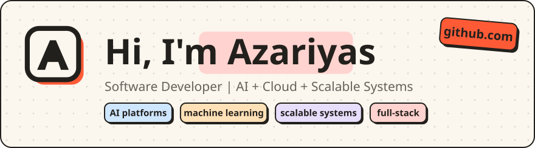</picture></a>

<a href="https://instagram.com/c0d5_kn4ght"><picture><source media="(prefers-color-scheme: dark)" srcset="assets/badge-yt-dark.svg"></picture></a>
<a href="https://x.com/azariyasme90324"><picture><source media="(prefers-color-scheme: dark)" srcset="assets/badge-x-dark.svg"></picture></a>
<a href="https://linkedin.com/in/azariyas-mekonen-000774378"><picture><source media="(prefers-color-scheme: dark)" srcset="assets/badge-li-dark.svg"></picture></a>
<a href="mailto:azariyasmekonen@gmail.com"><picture><source media="(prefers-color-scheme: dark)" srcset="assets/badge-site-dark.svg"></picture></a>

<picture><source media="(prefers-color-scheme: dark) and (max-width: 600px)" srcset="assets/github-phone-dark.svg"><source media="(max-width: 600px)" srcset="assets/github-phone-light.svg"><source media="(prefers-color-scheme: dark)" srcset="assets/github-dark.svg">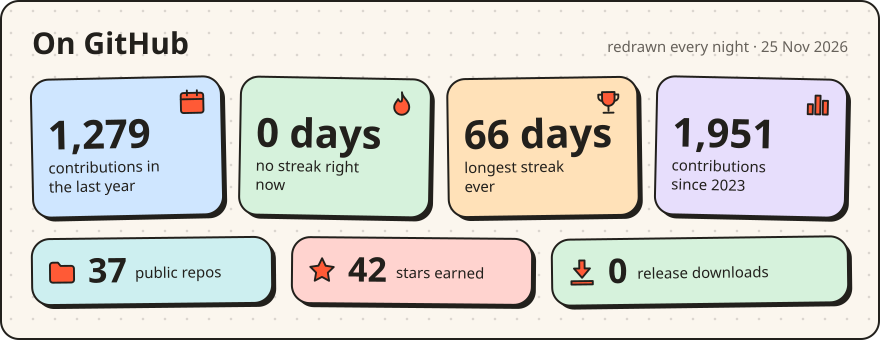</picture>

<picture><source media="(prefers-color-scheme: dark) and (max-width: 600px)" srcset="assets/graph-6m-phone-dark.svg"><source media="(max-width: 600px)" srcset="assets/graph-6m-phone-light.svg"><source media="(prefers-color-scheme: dark)" srcset="assets/graph-6m-dark.svg">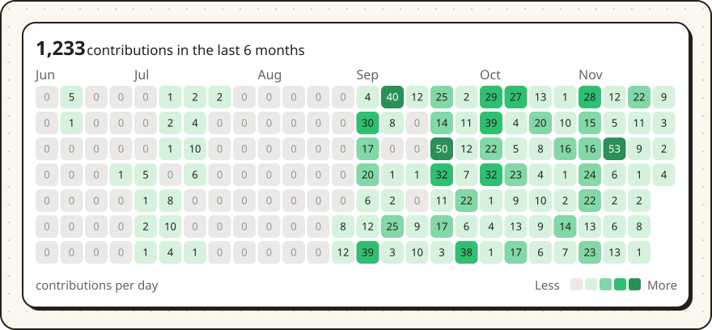</picture>

Last 12 months: 11,513 contributions

<picture><source media="(prefers-color-scheme: dark) and (max-width: 600px)" srcset="assets/graph-12m-phone-dark.svg"><source media="(max-width: 600px)" srcset="assets/graph-12m-phone-light.svg"><source media="(prefers-color-scheme: dark)" srcset="assets/graph-12m-dark.svg">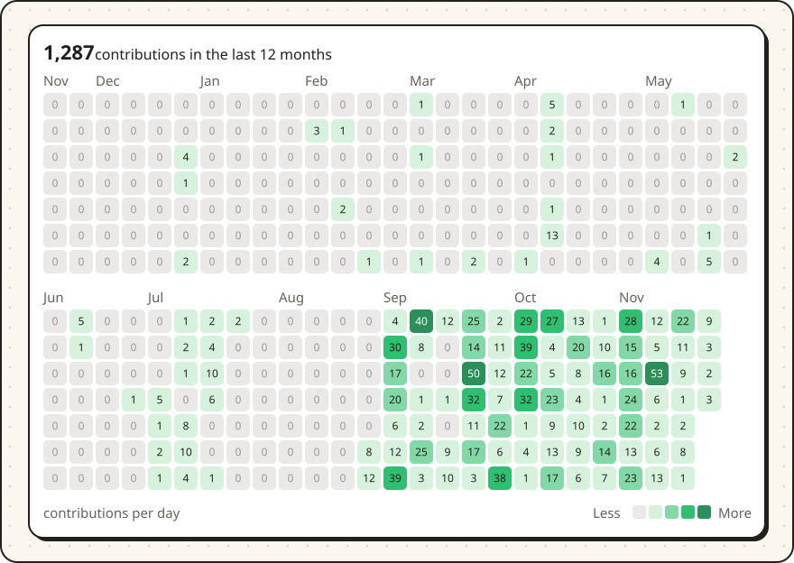</picture>

2026: 11,398 contributions

<picture><source media="(prefers-color-scheme: dark) and (max-width: 600px)" srcset="assets/graph-2026-phone-dark.svg"><source media="(max-width: 600px)" srcset="assets/graph-2026-phone-light.svg"><source media="(prefers-color-scheme: dark)" srcset="assets/graph-2026-dark.svg">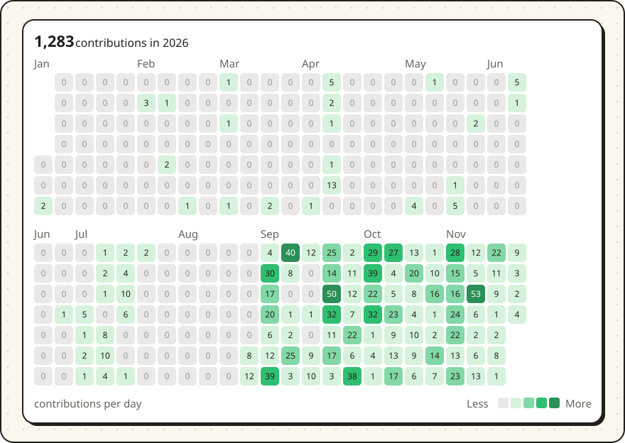</picture>

2025: 472 contributions

<picture><source media="(prefers-color-scheme: dark) and (max-width: 600px)" srcset="assets/graph-2025-phone-dark.svg"><source media="(max-width: 600px)" srcset="assets/graph-2025-phone-light.svg"><source media="(prefers-color-scheme: dark)" srcset="assets/graph-2025-dark.svg">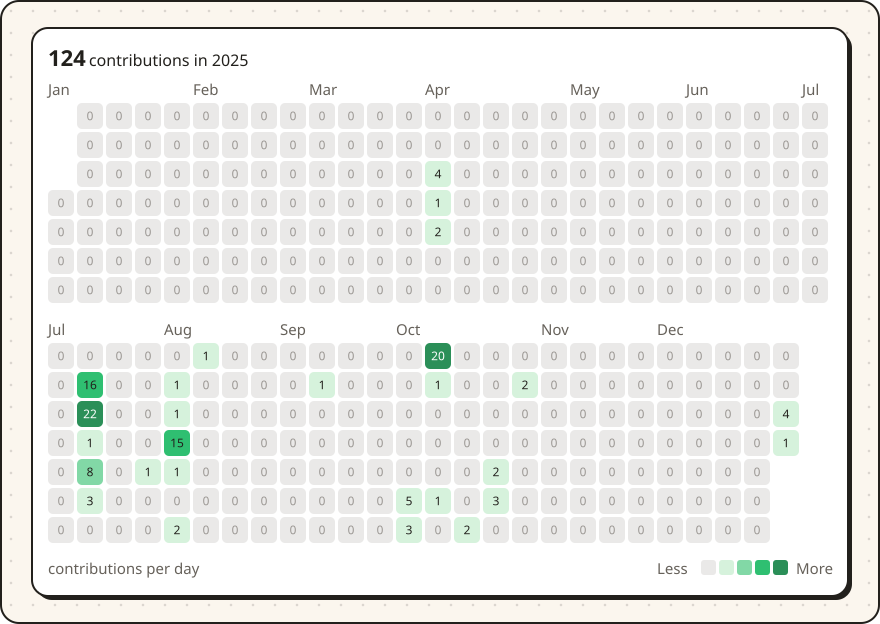</picture>

2024: 0 contributions

<picture><source media="(prefers-color-scheme: dark) and (max-width: 600px)" srcset="assets/graph-2024-phone-dark.svg"><source media="(max-width: 600px)" srcset="assets/graph-2024-phone-light.svg"><source media="(prefers-color-scheme: dark)" srcset="assets/graph-2024-dark.svg">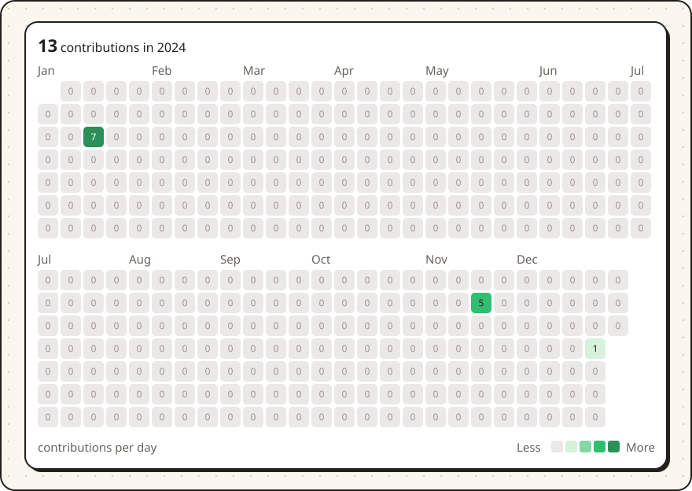</picture>

2023: 315 contributions

<picture><source media="(prefers-color-scheme: dark) and (max-width: 600px)" srcset="assets/graph-2023-phone-dark.svg"><source media="(max-width: 600px)" srcset="assets/graph-2023-phone-light.svg"><source media="(prefers-color-scheme: dark)" srcset="assets/graph-2023-dark.svg">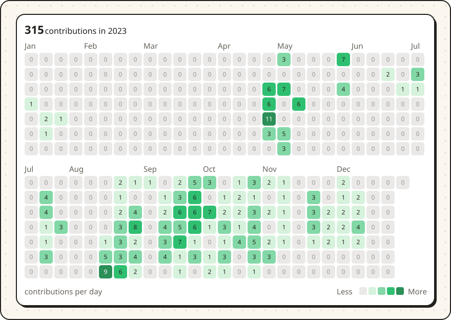</picture>

<picture><source media="(prefers-color-scheme: dark) and (max-width: 600px)" srcset="assets/line-30d-phone-dark.svg"><source media="(max-width: 600px)" srcset="assets/line-30d-phone-light.svg"><source media="(prefers-color-scheme: dark)" srcset="assets/line-30d-dark.svg">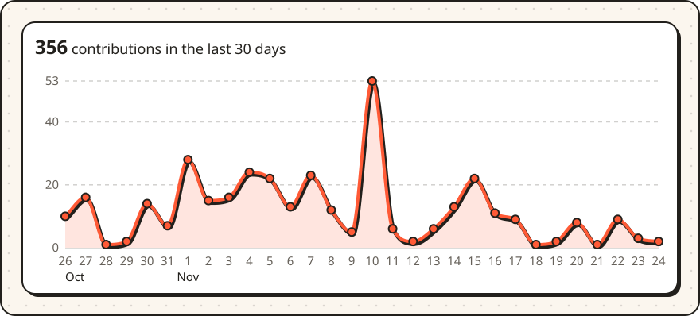</picture>

<picture><source media="(prefers-color-scheme: dark) and (max-width: 600px)" srcset="assets/whoami-phone-dark.svg"><source media="(max-width: 600px)" srcset="assets/whoami-phone-light.svg"><source media="(prefers-color-scheme: dark)" srcset="assets/whoami-dark.svg"></picture>

<picture><source media="(prefers-color-scheme: dark) and (max-width: 600px)" srcset="assets/label-ship-phone-dark.svg"><source media="(max-width: 600px)" srcset="assets/label-ship-phone-light.svg"><source media="(prefers-color-scheme: dark)" srcset="assets/label-ship-dark.svg"></picture>

<a href="https://github.com/AzariyasMekonen/Adera-AI"><picture><source media="(prefers-color-scheme: dark) and (max-width: 600px)" srcset="assets/app-adera-ai-phone-dark.svg"><source media="(max-width: 600px)" srcset="assets/app-adera-ai-phone-light.svg"><source media="(prefers-color-scheme: dark)" srcset="assets/app-adera-ai-dark.svg">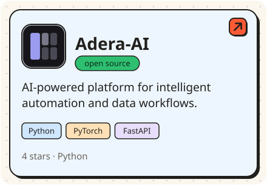</picture></a>
<a href="https://github.com/AzariyasMekonen/AMHARIC-ACOS"><picture><source media="(prefers-color-scheme: dark) and (max-width: 600px)" srcset="assets/app-amharic-acos-phone-dark.svg"><source media="(max-width: 600px)" srcset="assets/app-amharic-acos-phone-light.svg"><source media="(prefers-color-scheme: dark)" srcset="assets/app-amharic-acos-dark.svg">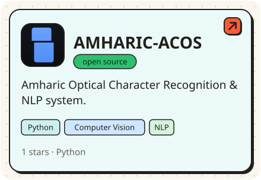</picture></a>
<a href="https://github.com/AzariyasMekonen/OWEN"><picture><source media="(prefers-color-scheme: dark) and (max-width: 600px)" srcset="assets/app-owen-phone-dark.svg"><source media="(max-width: 600px)" srcset="assets/app-owen-phone-light.svg"><source media="(prefers-color-scheme: dark)" srcset="assets/app-owen-dark.svg">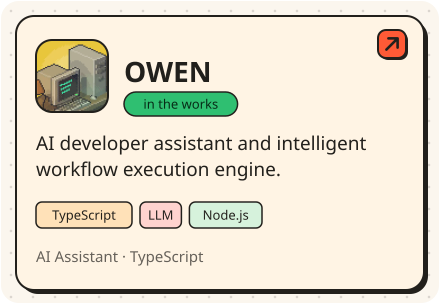</picture></a>
<a href="https://github.com/AzariyasMekonen/AdwaCTF.v2.front"><picture><source media="(prefers-color-scheme: dark) and (max-width: 600px)" srcset="assets/app-adwactf-phone-dark.svg"><source media="(max-width: 600px)" srcset="assets/app-adwactf-phone-light.svg"><source media="(prefers-color-scheme: dark)" srcset="assets/app-adwactf-dark.svg">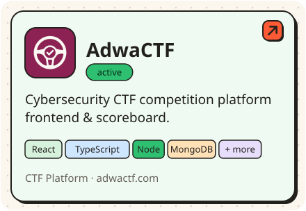</picture></a>

More projects & code: <a href="https://github.com/AzariyasMekonen/doc2deck">doc2deck</a> · <a href="https://github.com/AzariyasMekonen/baratieri-war-console">baratieri-war-console</a> · <a href="https://github.com/AzariyasMekonen/captured-maxim-gun">captured-maxim-gun</a> · <a href="https://github.com/AzariyasMekonen/Azu">Azu</a>

Interactive SVG Profile Cards · metrics updated nightly by GitHub Actions · <a href="https://github.com/AzariyasMekonen">github.com/AzariyasMekonen</a>

